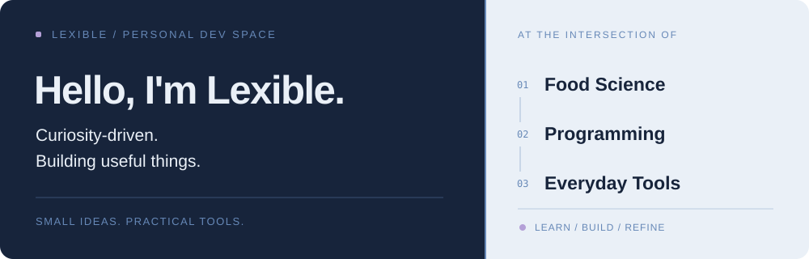

**Food Science × Programming × Everyday Tools**

*Curiosity-driven. Building useful things.*

## About Me · 关于我

食品科学与工程专业本科生，喜欢编程、技术探索，以及把生活中的具体问题转化为实用工具。

I'm a Food Science and Engineering undergraduate interested in programming, automation, and practical software. I enjoy learning by building and refining tools that solve everyday problems.

**Exploring:** Python · JavaScript · HTML/CSS · Git · AI-assisted development

## Selected Projects · 精选项目

| Project | What it does | Links |
| :-- | :-- | :-- |
| **FocusTodo Local** | 专注与任务管理工具 · Focus and productivity | [Code](https://github.com/menggou1/FocusTodo-Local) · [Live](https://menggou1.github.io/FocusTodo-Local/) |
| **Electricity Monitor** | 河南科技大学宿舍电量查询与记录 · Campus electricity utility | [Code](https://github.com/menggou1/check-electricity-public) |
| **Politics Tracker** | 基于 Streamlit 的考研政治刷题统计工具 · Study analytics | [Code](https://github.com/menggou1/kaoyan-politics-tracker) |
| **Daily Sentence** | 2027 考研每日一句 · Daily inspiration | [Code](https://github.com/menggou1/27-kaoyan-daily-sentence) · [Live](https://menggou1.github.io/27-kaoyan-daily-sentence/) |

More projects · 更多项目

- [CET_Query](https://github.com/menggou1/CET_Query) — CET score lookup utility.
- [leg-sis-keywords-anki-cards](https://github.com/menggou1/leg-sis-keywords-anki-cards) — Anki study cards and source materials.

## Activity · 开发动态

My public repositories and contribution history are available on [my GitHub profile](https://github.com/menggou1?tab=repositories).

---

Keep building. Keep learning.

