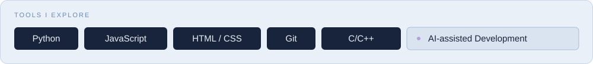

**食品科学 × 编程探索 × 日常工具**

Curiosity-driven. Building useful things.

[About](#about-me--关于我) · [Projects](#selected-projects--精选项目) · [Learning](#learning-notes--学习与记录) · [Connect](#connect--找到我)

## About Me · 关于我

**Lexible**，食品科学与工程专业本科生。

我经常编写用于学习和日常事务的小工具，涉及任务管理、校园信息查询和学习记录，也在项目中练习编程与自动化。

I'm **Lexible**, an undergraduate in Food Science and Engineering.

I regularly develop small tools for studying and everyday tasks, including task management, campus information lookup, and study tracking. These projects also serve as practice in programming and automation.

> 从一个具体问题开始，做一个真正用得上的工具。
> Start with a real problem. Build something useful.

## Current Focus · 正在探索

| 方向 | 经常涉及的内容 |
| :-- | :-- |
| **Everyday Tools** | 专注、任务管理与校园生活中的实用工具 |
| **Learning Systems** | 刷题记录、学习统计与知识整理 |
| **Programming & Automation** | 用 Python 和 JavaScript 把重复步骤变成更简洁的流程 |
| **Interface & Experience** | 清晰的信息结构、轻量的界面与顺手的操作 |

### Toolkit · 技术探索

这些是我正在接触和使用的工具；项目也是我的学习记录。

## Selected Projects · 精选项目

围绕日常效率、校园生活与学习记录，把小需求变成具体作品。

| Project | 场景与用途 | Explore |
| :-- | :-- | :-- |
| **FocusTodo Local** | **日常效率** · 专注与任务管理，把待办和专注过程放在一起 | [源码](https://github.com/menggou1/FocusTodo-Local) · [在线体验 ↗](https://menggou1.github.io/FocusTodo-Local/) |
| **Electricity Monitor** | **校园生活** · 河南科技大学宿舍电量查询与记录 | [源码 ↗](https://github.com/menggou1/check-electricity-public) |
| **Politics Tracker** | **学习记录** · 考研政治刷题统计工具 | [源码 ↗](https://github.com/menggou1/kaoyan-politics-tracker) |
| **Daily Sentence** | **每日学习** · 面向 2027 考研的每日一句 | [源码](https://github.com/menggou1/27-kaoyan-daily-sentence) · [在线体验 ↗](https://menggou1.github.io/27-kaoyan-daily-sentence/) |

<strong>More Projects · 更多小工具与学习资料</strong>

- [CET_Query](https://github.com/menggou1/CET_Query) — CET 成绩查询工具。
- [leg-sis-keywords-anki-cards](https://github.com/menggou1/leg-sis-keywords-anki-cards) — Anki 学习卡片与相关资料。
- [浏览全部仓库 ↗](https://github.com/menggou1?tab=repositories)

## How I Build · 做事方式

**01 / 从问题出发** — 先弄清楚使用场景，再决定需要哪些功能。

**02 / 先做小，再完善** — 从可用的版本开始，在实际使用中发现和打磨细节。

**03 / 保持清晰** — 整理页面结构，明确操作反馈，减少不必要的步骤。

**04 / 边做边学** — 把每个项目当作一次练习，也留下一份可以回看的记录。

## Learning Notes · 学习与记录

在专业学习之外，通过项目练习编程，并整理开发过程中的经验。当前的学习方向包括：

- **Python** — 数据整理、学习统计和轻量工具。
- **C/C++** — 语法基础、程序设计与编程练习。
- **JavaScript & HTML/CSS** — 网页交互、页面结构与界面表达。
- **Git & GitHub** — 版本管理、项目文档与持续迭代。
- **AI-assisted Development** — 在开发过程中练习拆解问题、理解代码与验证结果。

## Connect · 找到我

如果你也关注学习工具、校园生活中的小需求，或跨专业的编程探索，欢迎在相关项目的 Issues 中交流想法、反馈问题。

[GitHub · 项目与开发动态 ↗](https://github.com/menggou1) · [全部公开仓库 ↗](https://github.com/menggou1?tab=repositories)

---

**Lexible**

Keep building. Keep learning. Stay curious.

